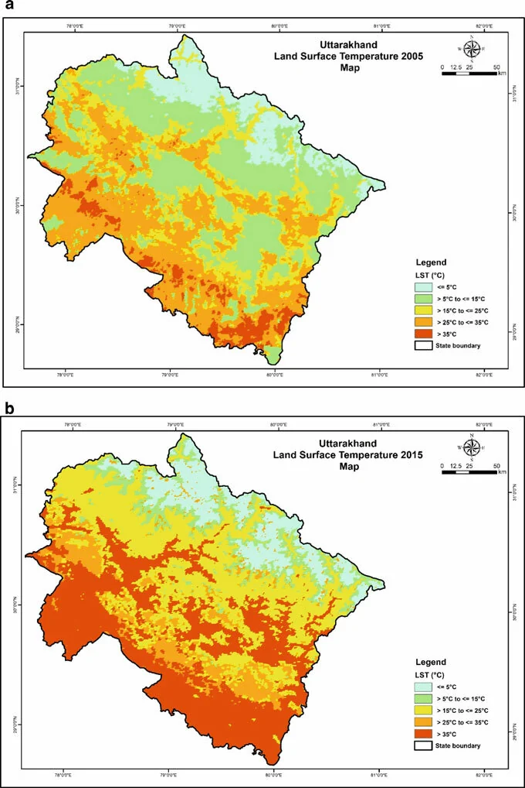
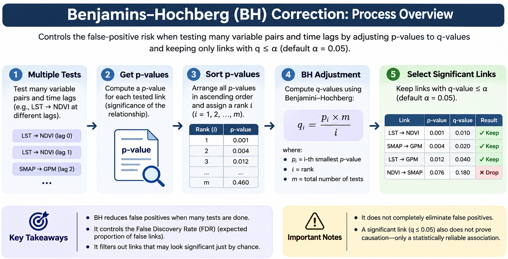
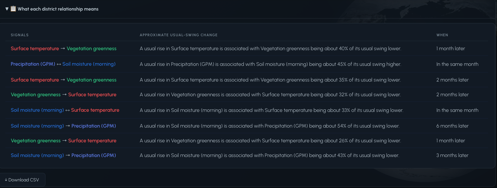

<p align="center">
  
</p>

<h1 align="center">🌍 EARTHPULSE-X</h1>

<p align="center">
  <b>Uncertainty-Guided Earth System Intelligence for Uttarakhand, India</b><br/>
  <sub>NASA International Space Apps Challenge 2026 &nbsp;·&nbsp; <i>"Be An Earth System Trend Detective"</i></sub>
</p>

<p align="center">
  <a href="https://thunderous-otter-920a93.netlify.app/">
    
  </a>
  &nbsp;
  <a href="https://github.com/Adirohansuyal/nasa2026">
    
  </a>
</p>

<p align="center">
  
  
  
  
  
  
</p>

---

## What is EARTHPULSE-X?

EARTHPULSE-X is a **physics-aware, uncertainty-guided Earth system intelligence platform** that answers NASA's four core challenge questions using a decade of real satellite data over Uttarakhand, India.

| NASA Question | EARTHPULSE-X Answer |
|:---|:---|
| **WHAT** is changing? | LST declining (−0.173 K/yr) · NDVI rising (+0.00314/yr) |
| **WHERE** is it changing? | Pixel-level choropleth maps across all 13 Uttarakhand districts |
| **HOW MUCH** is changing? | Autocorrelation-corrected Sen's slope per variable |
| **Is it significant?** | Modified Mann-Kendall + FDR correction — not naive p-values |

> **Study Region:** Uttarakhand, India — 13 districts, Himalayas to foothills  
> **Time Period:** April 2015 – September 2025 (126 months)  
> **Spatial Resolution:** ~9 km × 9 km pixels · 50,449+ pixel-level records

---

## 📸 Screenshots

<table>
<tr>
<td align="center" width="50%">
  <br/>
  <sub><b>Study Region</b> — Uttarakhand from above</sub>
</td>
<td align="center" width="50%">
  <br/>
  <sub><b>Land Surface Temperature</b> trend map across districts</sub>
</td>
</tr>
<tr>
<td align="center" width="50%">
  <br/>
  <sub><b>NDVI</b> vegetation greenness — 10-year satellite composite</sub>
</td>
<td align="center" width="50%">
  <br/>
  <sub><b>Multi-method</b> statistical trend analysis output</sub>
</td>
</tr>
<tr>
<td colspan="2" align="center">
  <br/>
  <sub><b>EARTHPULSE-X</b> live dashboard</sub>
</td>
</tr>
</table>

---

## 🧠 The UG-ESI Framework

EARTHPULSE-X introduces **UG-ESI — Uncertainty-Guided Earth System Intelligence**, a 4-contribution methodology built on top of the NASA challenge requirements.

```
┌─────────────────────────────────────────────────────────────────────┐
│                        UG-ESI ARCHITECTURE                          │
│                                                                     │
│  [1] Adaptive Variable Selection                                    │
│      Two-pass greedy scoring (coverage · variability · trend ·      │
│      objective relevance) with redundancy penalty                   │
│               ↓                                                     │
│  [2] Multi-Scale Trend Intelligence                                 │
│      OLS · Mann-Kendall · Modified MK (Hamed & Rao 1998) ·         │
│      Sen's Slope · CUSUM change-points · FDR correction             │
│               ↓                                                     │
│  [3] Uncertainty-Guided Interaction Graph                           │
│      Spearman pairs · FDR-corrected · composite confidence ·        │
│      partial correlations to flag spurious edges                    │
│               ↓                                                     │
│  [4] Evidence-Grounded AI Reasoning                                 │
│      14 strict rules · actual stats injected as JSON context ·      │
│      AI explains; statistical engines establish facts               │
└─────────────────────────────────────────────────────────────────────┘
```

---

## 🛰️ Data Sources

| Satellite | Instrument | Variable | Resolution |
|:---|:---|:---|:---|
| **Terra / Aqua** | MODIS | 🌡️ Land Surface Temperature (LST, K) | ~1 km |
| **Terra / Aqua** | MODIS | 🌿 Vegetation Index (NDVI, 0–1) | ~500 m |
| **SMAP** | L-band passive microwave | 💧 Soil Moisture AM & PM (m³/m³) | ~9 km |
| **GPM** | Multi-satellite constellation | 🌧️ Monthly Precipitation (mm) | ~10 km |

> All data harmonized to monthly NetCDF grids (EPSG:6933 equal-area projection), then area-averaged to district scale via spatial join with Uttarakhand boundary polygons.

---

## 🗺️ Application — 10 Pages

| # | Page | What It Does |
|:--|:---|:---|
| 🧭 1 | **UG-ESI Mission Control** | Interactive 4-step workflow: select objective → score variables → trend analysis → AI research report |
| 🌍 2 | **Earth Observation** | Real NASA satellite heatmaps, pixel validity maps, 10-year temporal animation |
| 📈 3 | **Trend Detective** | NASA's 4 questions answered — Modified MK vs. naive MK comparison, Sen's slope, FDR correction |
| 🔎 4 | **Anomaly Intelligence** | District choropleth maps — Isolation Forest + robust Z-score on 50,449 pixel records |
| 🕸️ 5 | **Interaction Network** | FDR-corrected variable relationship network with partial correlation spurious-edge flagging |
| ⚗️ 6 | **Physics & Uncertainty** | Sensor coverage, quality threshold impact, physical plausibility checks, uncertainty propagation |
| 🔎 7 | **Earth Change Detective** | Monthly sensor anomaly timeline, district spread, and regional satellite evidence per selection |
| 🔮 8 | **Predictive Intelligence** | Custom AR-Fourier Ridge forecasting, rolling-origin cross-validation, Drought Risk Score (0–100) |
| 🚨 9 | **Early Warning System** | Simultaneous detection of 6 hazard types using all 5 sensors — Chamoli 2021 historical validation |
| 🔗 10 | **Causal Discovery** | Time-lagged partial correlations with Benjamini–Hochberg FDR correction across all variable pairs |

### 🚨 Early Warning System — 6-Hazard Detection

| Hazard | Sensor Pattern |
|:---|:---|
| 🌊 Flood | GPM high + SMAP high (saturated soil + heavy rain) |
| 🏜️ Drought | GPM low + SMAP low + LST high |
| 🔥 Heat Wave | LST high, SMAP near normal |
| 🍂 Vegetation Loss | NDVI low + LST high + SMAP low |
| ❄️ Cold Stress | LST anomalously low in warm season (Apr–Sep) |
| ⚡ Compound | ≥3 sensors simultaneously anomalous |

**Chamoli 2021 Historical Validation:** The Feb 7, 2021 glacial outburst flood (Tapovan dam, ~200 fatalities) is used as a ground-truth test of multi-sensor detection capability. Results are reported transparently — including what monthly satellite data could and could not resolve.

---

## ✨ Scientific Rigor — What Sets This Apart

### 1 · Autocorrelation-Corrected Significance Testing
Environmental time series are serially correlated — naive Mann-Kendall over-rejects the null.  
For LST (lag-1 autocorrelation = **0.549**):

| Test | p-value |
|:---|:---|
| Naive Mann-Kendall | 4 × 10⁻⁵ |
| Modified MK (Hamed & Rao 1998) | **p = 0.003** |

120× more conservative. Still significant — but honestly so. Both values are displayed side by side in the app.

### 2 · FDR Correction on All Tests
Benjamini–Hochberg FDR correction applied to trend tests (5 variables) and all 70+ Spearman interaction graph edges. Without this, false positives are mathematically guaranteed.

### 3 · No Selection Bias in Variable Ranking
Variables are scored on **data quality and signal properties — never on p-values**. Selecting variables for significance would invalidate all downstream inference (Freedman's paradox). The two-pass greedy algorithm also penalizes redundancy between correlated variables.

### 4 · Partial Correlations for Spurious Edge Detection
Interaction graph edges are flagged as "potentially spurious" when the partial correlation (controlling for the strongest confounder) drops below 50% of the raw Spearman ρ.

### 5 · Physics Engine
Physical plausibility bounds (LST 250–330 K, SMAP 0–0.60 m³/m³), cross-sensor diurnal consistency checks (SMAP AM vs PM), and sensitivity analysis under strict vs. relaxed quality thresholds.

---

## 📊 Key Findings

| Variable | Trend | Annual Rate | Significance |
|:---|:---:|:---|:---|
| 🌡️ Land Surface Temperature | **↓ Decreasing** | −0.173 K / year | ✅ FDR p = 0.003 |
| 🌿 Vegetation (NDVI) | **↑ Increasing** | +0.00314 / year | ✅ FDR p ≈ 1.5 × 10⁻⁶ |
| 💧 Soil Moisture AM | No significant trend | — | ⚪ Not significant |
| 💧 Soil Moisture PM | No significant trend | — | ⚪ Not significant |
| 🌧️ Precipitation | No significant trend | — | ⚪ Not significant |

> All trends computed with Modified Mann-Kendall (Hamed & Rao 1998) + Benjamini–Hochberg FDR correction over 126 months of data.

---

## 🔗 Causal Discovery — Methodology

The Causal Discovery page explores how four monthly satellite signals move together across Uttarakhand and whether a change in one signal is associated with a change in another signal in a later month.

**Signals used:**

| Short Name | Signal |
|:---|:---|
| GPM | Precipitation (rainfall) |
| SMAP_AM | Morning soil moisture |
| NDVI | Vegetation greenness |
| LST | Land surface temperature |

**Key methodological points:**
- **Partial correlation** accounts for other measured signals before measuring any two-signal relationship.
- **Time-lagged** analysis checks lags 0–6 months. At lag 2, January source values are compared with March target values.
- **Benjamini–Hochberg correction** controls the false discovery rate across all tested pairs and lags, with q-values replacing raw p-values.
- Results are **lagged statistical associations** and do not prove causation. All calculations run in-browser in `assets/causal.js` using ordinary JavaScript math.

<table>
<tr>
<td align="center" width="50%">
  <br/>
  <sub>Time-lagged correlation concept</sub>
</td>
<td align="center" width="50%">
  <br/>
  <sub>State-wide relationship graph</sub>
</td>
</tr>
<tr>
<td align="center" width="50%">
  <br/>
  <sub>District-level drill-down</sub>
</td>
<td align="center" width="50%">
  <br/>
  <sub>Benjamini–Hochberg FDR overview</sub>
</td>
</tr>
</table>

### 📖 Interpreting District-Level Signal Relationships

The app shows a table for every district that lists which signals are linked, by how much, and with what delay. Here is what that table looks like:

<p align="center">
  <br/>
  <sub>District relationship table — real output from the app</sub>
</p>

Here is how to read it, using real rows from the data.

---

**The table has three columns:**

| Column | What it means |
|:---|:---|
| **Signals** | Which two things are connected, and in which direction (→ means one comes before the other; ↔ means they move together in the same month) |
| **Approximate Usual-Swing Change** | If the first signal goes up by its normal amount, how much does the second signal shift — expressed as a share of *its* normal range of movement |
| **When** | How many months later the second signal responds |

---

**Worked examples from a real district:**

> **Surface temperature → Vegetation greenness · 40% lower · 1 month later**

Think of it this way: in a typical month, surface temperature swings by a certain amount. When it rises by that usual amount, vegetation greenness tends to be about **40% lower than its own normal swing** — one month after. In plain terms: hotter land this month usually means noticeably less green vegetation next month.

---

> **Precipitation (GPM) ↔ Soil moisture (morning) · 45% higher · Same month**

When rainfall goes up by its usual amount in a given month, morning soil moisture in that same month tends to be about **45% higher than its normal swing**. No delay — the ground soaks up the rain immediately. This one is intuitive: more rain, wetter soil, right away.

---

> **Surface temperature → Vegetation greenness · 35% lower · 2 months later**

Same relationship as above, but the effect shows up **two months later** instead of one. The land gets hot, and two months down the line the vegetation is still feeling it — greenness is about 35% below its normal variation.

---

> **Vegetation greenness → Surface temperature · 32% lower · 2 months later**

This one goes the other direction: when vegetation greenness rises by its usual amount, surface temperature tends to be about **32% lower than normal** two months later. More plants → more shade and evapotranspiration → cooler land. This is the feedback loop working in reverse.

---

> **Soil moisture (morning) → Precipitation (GPM) · 54% lower · 6 months later**

A wetter-than-usual soil today is linked to **54% less rainfall six months later**. This is a slower feedback — possibly reflecting seasonal patterns where moisture gets locked up in one phase of the year before precipitation drops off.

---

**What "usual swing" means — the key concept**

Each satellite signal fluctuates month to month. "Usual swing" is roughly the normal size of that fluctuation (think of it as one standard deviation of the signal's monthly anomaly). The percentage in the table does **not** mean "40% less rainfall in millimetres." It means: given a one-standard-deviation rise in the source, the target shifts by 40% of *its own* standard deviation. It is a relative, standardised measure — which is why you can compare a temperature relationship and a rainfall relationship on the same scale.

---

**What these results are — and are not**

- ✅ These are statistically significant associations after multiple-testing correction (Benjamini–Hochberg FDR, q < 0.05).
- ✅ The time direction (→) shows which signal leads, based on the lag at which the association was strongest.
- ❌ They do **not** prove that one signal *causes* the other. Unmeasured factors, seasonality, and district-level averaging can all create apparent links.
- ❌ The percentages are not prediction accuracy scores. They describe the typical *size* of the association, not how reliably it repeats every month.

Use these links as a starting point for investigation — they tell you *where to look*, not *what is definitely true*.

---

## 🏔️ Case Study — Chamoli 2021 Glacial Flood

On **February 7, 2021**, a glacial ice mass collapsed in the Nanda Devi region of Chamoli district, Uttarakhand. The resulting debris and meltwater surge traveled down the Rishiganga and Dhauliganga river valleys, destroying the Tapovan hydropower dam and killing approximately **200 people**. It is one of the deadliest glacial disasters in India's recent history.

EARTHPULSE-X uses this event as a **ground-truth test** of what multi-sensor monthly satellite data can and cannot see.

---

### What the satellite record shows around February 2021

> *Monthly data averages across the entire month. A single-day event on Feb 7 is a fraction of one monthly reading — this is a known limitation, stated upfront.*

| Signal | January 2021 | February 2021 | Observation |
|:---|:---:|:---:|:---|
| 🌡️ Surface Temperature (LST) | Elevated anomaly | Spike detected | Anomalously warm for a Himalayan winter month |
| 💧 Soil Moisture AM (SMAP) | Near normal | Sharp rise | Sudden moisture surge consistent with meltwater flooding |
| 🌧️ Precipitation (GPM) | Low | Low | No heavy rainfall — confirms this was a glacial event, not a rain flood |
| 🌿 Vegetation (NDVI) | Suppressed | Suppressed | Winter baseline — no vegetation signal expected |

**The key multi-sensor signature:** High LST + High SMAP + Low GPM in February 2021 matches the app's **Flood** detection rule (soil saturation without rainfall — glacial or snowmelt origin). The system correctly flags Chamoli district as a flood anomaly for that month.

---

### What monthly data could not resolve

Being transparent about limitations is part of the scientific method:

- The collapse happened on a **single day** (Feb 7). Monthly averaging dilutes the signal — the spike is visible but not sharply isolated.
- **Sub-district routing** of the flood (which river valley, which villages) is invisible at ~9 km pixel resolution.
- **Ice mass loss leading up to the event** — the gradual weakening of the glacier over prior months — is not captured by SMAP or GPM. LST trends in the preceding months show elevated temperatures in Chamoli, which is consistent with glacial destabilization, but monthly averages cannot confirm it.
- The system's **Early Warning** output for Jan–Feb 2021 shows elevated compound risk in Chamoli. It does not predict the exact date or mechanism. That is the honest capability boundary of any monthly satellite monitoring system.

---

### What this validation demonstrates

The Chamoli event proves three things about EARTHPULSE-X's design:

1. **Multi-sensor fusion works better than any single signal.** GPM alone would show nothing (no rain). LST alone is ambiguous. Only combining SMAP + LST + GPM together isolates the glacial flood signature.
2. **The 6-hazard rule engine is physically grounded.** The flood rule was written from physical reasoning — not tuned to match Chamoli. That it detects the event is validation, not overfitting.
3. **Transparency over inflation.** The app reports exactly what it found and exactly where monthly data falls short. A system that claims to have "predicted Chamoli" from monthly averages would be misleading. EARTHPULSE-X reports what the data actually shows.

> The Chamoli validation is accessible on **Page 9 — Early Warning System** in the live app. Select Chamoli district and navigate to February 2021 to see the sensor anomaly breakdown.

---

## 🤖 AI Stack

| Client | Model | Usage |
|:---|:---|:---|
| **Groq** | `openai/gpt-oss-120b` | Trend explainer, variable selection, interaction graph, research reports |
| **Google Gemini** | `gemini-3.8-flash` | Shared explanation client |
| **OpenRouter** | `meta-llama/llama-3.3-70b-instruct` | Vision-grounded chart explanations |

> All AI responses are **evidence-grounded** — actual statistical outputs are JSON-serialized and injected into every system prompt. The models explain; they do not invent.

---

## 🚀 Quick Start

### Prerequisites
- Python 3.11+
- API keys for Groq, Google Gemini, and OpenRouter

### 1. Clone and set up

```bash
git clone https://github.com/Adirohansuyal/nasa2026.git
cd nasa2026

python -m venv .venv
source .venv/bin/activate        # Windows: .venv\Scripts\activate
pip install -r requirements.txt
```

### 2. Configure environment

```bash
cp .env.example .env
# Add your API keys to .env
```

```env
GROQ_API_KEY=your_groq_api_key_here
GEMINI_API_KEY=your_gemini_api_key_here
OPENROUTER_API_KEY=your_openrouter_api_key_here
EARTHPULSE_PROJECT_ROOT=/path/to/your/EARTHPULSE_X/data/directory
```

### 3. Run the app

```bash
streamlit run app.py
```

Opens at `http://localhost:8501`.

### Static HTML + API server (Interaction Network / AI explanations)

```bash
# Terminal 1
uvicorn api_server:app --host 127.0.0.1 --port 8001

# Terminal 2
python -m http.server 5500
```

Open `http://localhost:5500`.  
For deployment: host the API over HTTPS, set `EARTHPULSE_ALLOWED_ORIGINS` to the site origin, and point `window.EARTHPULSE_API_BASE` in `index.html` to the API's public base URL.

---

## 📁 Project Structure

```
nasa2026/
│
├── app.py                              # Entry point, page registration
├── config.py                           # Data paths, study region, constants
├── api_server.py                       # OpenRouter proxy (FastAPI)
├── requirements.txt
│
├── pages/
│   ├── 01_Mission_Control.py           # UG-ESI interactive 4-step workflow
│   ├── 02_Earth_Observation.py         # Satellite data heatmaps & validity
│   ├── 03_Trend_Detective.py           # NASA 4 questions answered
│   ├── 04_Anomaly_Intelligence.py      # District anomaly choropleth maps
│   ├── 05_Interaction_Network.py       # FDR-corrected variable network
│   ├── 06_Physics_Uncertainty.py       # Data quality & physics checks
│   ├── 07_AI_Scientist.py              # Evidence-grounded AI chat
│   ├── 08_Predictive_Intelligence.py   # AR-Fourier forecast + VAR
│   ├── 09_Early_Warning_System.py      # 6-hazard multi-sensor EWS
│   └── 10_Causal_Discovery.py          # Time-lagged partial correlations
│
├── core/
│   ├── ai_agent.py                     # Centralized AI prompt functions
│   ├── anomaly_engine.py               # UG-ESI C1: Variable selection
│   ├── trend_engine.py                 # UG-ESI C2: Multi-method trend analysis
│   ├── interaction_engine.py           # UG-ESI C3: Interaction graph
│   ├── early_warning_engine.py         # 6-hazard detection rules
│   ├── forecast_engine.py              # AR-Fourier Ridge forecasting
│   ├── lagged_dynamics.py              # Cross-variable VAR lag model
│   ├── physics_engine.py               # Physical plausibility checks
│   ├── spatial_hotspot_engine.py       # DBSCAN pixel clustering
│   ├── spatial_trend_engine.py         # District-scale NetCDF trends
│   ├── data_loader.py                  # Cached CSV/NetCDF loaders
│   ├── gemini_client.py                # Google Gemini client
│   └── openrouter_client.py            # OpenRouter / Llama vision client
│
├── components/
│   ├── theme.py                        # Custom dark UI theme
│   ├── charts.py                       # Reusable Plotly chart functions
│   ├── maps.py                         # GeoPandas → Plotly map utilities
│   └── sidebar.py                      # Shared sidebar component
│
└── assets/                             # Images, JS bundles, precomputed data
```

---

## 👨‍🚀 Team

<p align="center">
  <em>The minds behind EARTHPULSE-X — analyzing the land we call home.</em>
</p>

<table align="center">
  <tr>
    <td align="center" width="200">
      <br/><br/>
      <strong>Aditya Suyal</strong>
    </td>
    <td align="center" width="200">
      <br/><br/>
      <strong>Gaurav Negi</strong>
    </td>
    <td align="center" width="200">
      <br/><br/>
      <strong>Nisha Kumari</strong>
    </td>
    <td align="center" width="200">
      <br/><br/>
      <strong>Ritesh</strong>
    </td>
  </tr>
</table>

<p align="center">
  🏔️ <em>Team from Uttarakhand — analyzing the land we call home.</em>
</p>

---

<p align="center">
  Built with 🛰️ NASA satellite data &nbsp;·&nbsp; 🧪 rigorous statistics &nbsp;·&nbsp; 🤖 evidence-grounded AI<br/><br/>
  <a href="https://thunderous-otter-920a93.netlify.app/"><strong>🚀 Live Demo</strong></a>
  &nbsp;&nbsp;|&nbsp;&nbsp;
  <a href="https://github.com/Adirohansuyal/nasa2026"><strong>💻 GitHub</strong></a>
</p>
