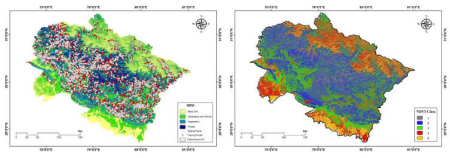

<p align="center">
  
</p>

<h1 align="center">🌍 EARTHPULSE-X</h1>
<h3 align="center">Uncertainty-Guided Earth System Intelligence for Uttarakhand, India</h3>

<p align="center">
  <strong>NASA Space Apps Challenge 2026 · "Be An Earth System Trend Detective"</strong>
</p>

<p align="center">
  
  
  
  
  
</p>

---

##  What Is EARTHPULSE-X?

EARTHPULSE-X is a **physics-aware, uncertainty-guided Earth system intelligence platform** that answers NASA's four core challenge questions using a decade of real satellite data:

| NASA Question | Our Answer |
|---|---|
| **WHAT** is changing? | LST declining (−0.173 K/yr) · NDVI rising (+0.00314/yr) |
| **WHERE** is it changing? | Pixel-level choropleth maps across 13 Uttarakhand districts |
| **HOW MUCH** is changing? | Autocorrelation-corrected Sen's slope estimates per variable |
| **Is it significant?** | Modified Mann-Kendall + FDR correction (not naive p-values) |

**Study Region:** Uttarakhand, India — 13 districts, Himalayas to foothills  
**Time Period:** April 2015 – September 2025 (126 months)  
**Spatial Resolution:** ~9 km × 9 km pixels · 50,449+ pixel-level records

---

## 📸 Screenshots

<table>
<tr>
<td align="center">
  <br/>
  <sub>Study Region — Uttarakhand from above</sub>
</td>
<td align="center">
  <br/>
  <sub>Land Surface Temperature trends across districts</sub>
</td>
</tr>
<tr>
<td align="center">
  <br/>
  <sub>NDVI vegetation greenness — 10-year satellite composite</sub>
</td>
<td align="center">
  <br/>
  <sub>Multi-method statistical trend analysis output</sub>
</td>
</tr>
<tr>
<td colspan="2" align="center">
  <br/>
  <sub>EARTHPULSE-X live dashboard</sub>
</td>
</tr>
</table>

---

## 🧠 The UG-ESI Framework (Our Core Contribution)

EARTHPULSE-X introduces **UG-ESI — Uncertainty-Guided Earth System Intelligence**, a 4-contribution methodology built on top of the NASA challenge requirements:

```
┌─────────────────────────────────────────────────────────────────────┐
│                        UG-ESI ARCHITECTURE                          │
│                                                                     │
│  [1] Adaptive Variable Selection                                    │
│      Two-pass greedy scoring (coverage · variability · trend ·      │
│      objective relevance) with redundancy penalty                   │
│               ↓                                                     │
│  [2] Multi-Scale Trend Intelligence                                 │
│      OLS · Mann-Kendall · Modified MK (Hamed & Rao 1998) ·         │
│      Sen's Slope · CUSUM change-points · FDR correction             │
│               ↓                                                     │
│  [3] Uncertainty-Guided Interaction Graph                           │
│      Spearman pairs · FDR-corrected · composite confidence ·        │
│      partial correlations to flag spurious edges                    │
│               ↓                                                     │
│  [4] Evidence-Grounded AI Reasoning                                 │
│      14 strict rules · actual stats injected as JSON context ·      │
│      AI explains; statistical engines establish facts               │
└─────────────────────────────────────────────────────────────────────┘
```

---

## 🛰️ Data Sources

| Satellite | Instrument | Variables | Resolution |
|---|---|---|---|
| **Terra / Aqua** | MODIS | 🌡️ Land Surface Temperature (LST, Kelvin) | ~1 km |
| **Terra / Aqua** | MODIS | 🌿 Vegetation Index (NDVI, 0–1) | ~500 m |
| **SMAP** | L-band passive microwave | 💧 Soil Moisture AM & PM (m³/m³) | ~9 km |
| **GPM** | Multi-satellite constellation | 🌧️ Monthly Precipitation (mm) | ~10 km |

All data harmonized to monthly NetCDF grids (EPSG:6933 equal-area projection), then area-averaged to district scale via spatial join with Uttarakhand boundary polygons.

---

## 🗺️ Application Pages

### 🧭 Page 1 — UG-ESI Mission Control
Run all four UG-ESI contributions interactively in one workflow:
1. Choose a research objective (drought / flood / vegetation / temperature / general)
2. Watch the system score and rank all 5 variables automatically
3. Explore multi-method trend analysis with significance testing
4. Navigate the uncertainty-guided interaction graph
5. Generate a full AI research report grounded in your actual statistical outputs

### 🌍 Page 2 — Earth Observation
Real NASA satellite data visualized as geographic heatmaps. Pixel-level validity maps. Strict vs. relaxed quality comparison. 10-year temporal animation.

### 📈 Page 3 — Trend Detective *(NASA's 4 Questions, answered)*
Pre-computed autocorrelation-adjusted trend results across all 5 variables with:
- Modified Mann-Kendall vs. naive MK comparison (see why autocorrelation correction matters)
- Sen's slope annual change estimates
- FDR-adjusted significance across all tests
- Annual anomaly heatmaps — WHERE and WHEN things changed

> **Key Finding:** LST is significantly **decreasing** at −0.173 K/yr (FDR p = 0.003). NDVI is significantly **increasing** at +0.00314/yr (FDR p ≈ 1.5 × 10⁻⁶). Soil moisture and precipitation trends are not statistically significant.

### 🔎 Page 4 — Anomaly Intelligence
Spatial choropleth maps showing which of the 13 Uttarakhand districts had the highest anomaly pixel percentage. Pixel-level Isolation Forest + robust Z-score detection (threshold |Z| > 3.5) on 50,449 spatial records.

### 🕸️ Page 5 — Interaction Network
FDR-corrected variable relationship network across lag windows 0–6 months. Edge width = |ρ|, edge color = direction (green positive / red negative). Partial correlation filtering flags spurious edges driven by confounders.

### ⚗️ Page 6 — Physics & Uncertainty
Data quality and reliability dashboard. Sensor coverage over 10 years. Strict vs. relaxed quality threshold impact analysis. Physical plausibility checks. Contradictory signal detection. Uncertainty propagation from coverage gaps.

### 🔎 Page 7 — Earth Change Detective
Choose an Earth-system signal, district, and month to inspect the monthly sensor anomaly timeline, district-level spread, and the regional satellite evidence for that month. Detected months are clearly separated from regional sensor context; the map summarizes district signals and does not imply confirmed impacts or causal relationships.

### 🔮 Page 8 — Predictive Intelligence
Custom seasonal AR-Fourier Ridge forecast model (zero dependency on Prophet/LSTM). Rolling-origin cross-validation auto-selects lag depth and regularization. Residual bootstrap forecast intervals. Cross-variable lag VAR analysis with F-test significance. Drought Risk Score (0–100) composite index.

### 🚨 Page 9 — Early Warning System *(Multi-Hazard)*
The most unique feature: simultaneous detection of **6 hazard types** using all 5 sensors together:

| Hazard | Signal Pattern |
|---|---|
| 🌊 Flood | GPM high + SMAP high (saturated + heavy rain) |
| 🏜️ Drought | GPM low + SMAP low + LST high |
| 🔥 Heat Wave | LST high, SMAP near normal |
| 🍂 Vegetation Loss | NDVI low + LST high + SMAP low |
| ❄️ Cold Stress | LST anomalously low in warm season (Apr–Sep) |
| ⚡ Compound | ≥3 sensors simultaneously anomalous |

**Chamoli 2021 Historical Validation:** The Feb 7, 2021 glacial outburst flood (Tapovan dam, ~200 fatalities) is used as a ground-truth test of multi-sensor detection capability. Results are reported transparently — including what monthly satellite data could and could not resolve.

---

## ✨ What Makes This Scientifically Rigorous?

### 1. Autocorrelation-Corrected Significance Testing
Environmental time series are serially correlated — naive Mann-Kendall over-rejects the null. For LST (lag-1 autocorrelation = **0.549**):
- Naive MK p-value: **4 × 10⁻⁵**
- Modified MK (Hamed & Rao 1998): **p = 0.003**
- 120× more conservative. Still significant, but honestly so.

The app displays both values side by side so you can see the difference.

### 2. FDR Correction on All Tests
Benjamini-Hochberg FDR correction applied to:
- Trend tests (5 variables)
- Interaction graph edges (70+ Spearman tests across variable pairs and lag windows)

Without this, random false positives are guaranteed.

### 3. No Selection Bias in Variable Ranking
Variables are scored on **data quality and signal properties** — never on p-values. Selecting variables because they are significant would invalidate all downstream statistical inference (Freedman's paradox). The two-pass greedy algorithm also penalizes redundancy between correlated variables.

### 4. Partial Correlations for Spurious Edge Detection
Interaction graph edges are flagged as "potentially spurious" when the partial correlation (controlling for the strongest confounder) drops below 50% of the raw Spearman ρ — a rare feature at this project scale.

### 5. Physics Engine
Physical plausibility bounds (e.g., LST 250–330 K, SMAP 0–0.60 m³/m³), cross-sensor consistency checks (SMAP AM vs PM diurnal range), and sensitivity analysis of trend conclusions under strict vs. relaxed quality thresholds.

---

## 🤖 AI Stack

| Client | Model | Usage |
|---|---|---|
| **Groq** | `openai/gpt-oss-120b` | Trend explainer, variable selection explainer, interaction graph, research reports |
| **Google Gemini** | `gemini-3.8-flash` | Shared explanation client |
| **OpenRouter** | `meta-llama/llama-3.3-70b-instruct` | Vision-grounded chart explanations |

All AI responses are **evidence-grounded**: actual statistical outputs are JSON-serialized and injected into every system prompt. The models explain; they do not invent.

---

## 🚀 Quick Start

### Prerequisites
- Python 3.11+
- Access to the EARTHPULSE-X research data directory (NASA processed NetCDF files)

### 1. Clone and set up environment

```bash
git clone <repository-url>
cd EARTHPULSE_APP

python -m venv .venv
source .venv/bin/activate        # Windows: .venv\Scripts\activate
pip install -r requirements.txt
```

### 2. Configure environment variables

```bash
cp .env.example .env
# Edit .env and add your API keys
```

Required keys in `.env`:

```
GROQ_API_KEY=your_groq_api_key_here
GEMINI_API_KEY=your_gemini_api_key_here
OPENROUTER_API_KEY=your_openrouter_api_key_here
EARTHPULSE_PROJECT_ROOT=/path/to/your/EARTHPULSE_X/data/directory
```

### 3. Run the app

```bash
streamlit run app.py
```

The app will open at `http://localhost:8501`.

### Static `index.html` AI explanations

The Interaction Network and Haldwani-to-nearby-town explanation buttons use the small server-side OpenRouter proxy in `api_server.py`. Keep the OpenRouter key in the private `.env` file; never put it in browser JavaScript.

Run the API and static site in separate terminals:

```bash
uvicorn api_server:app --host 127.0.0.1 --port 8001
python -m http.server 5500
```

Open `http://localhost:5500`. For deployment, host the API over HTTPS, set `EARTHPULSE_ALLOWED_ORIGINS` to the website's exact origin, and set `window.EARTHPULSE_API_BASE` in `index.html` to the API's public base URL.

---

## 📁 Project Structure

```
EARTHPULSE_APP/
│
├── app.py                          # Entry point, page registration
├── config.py                       # Data paths, study region, constants
├── requirements.txt
│
├── pages/
│   ├── 01_Mission_Control.py       # UG-ESI interactive 4-step workflow
│   ├── 02_Earth_Observation.py     # Satellite data heatmaps & validity
│   ├── 03_Trend_Detective.py       # NASA 4 questions answered
│   ├── 04_Anomaly_Intelligence.py  # District anomaly choropleth maps
│   ├── 05_Interaction_Network.py   # FDR-corrected variable network
│   ├── 06_Physics_Uncertainty.py   # Data quality & physics checks
│   ├── 07_AI_Scientist.py          # Evidence-grounded AI chat
│   ├── 08_Predictive_Intelligence.py  # AR-Fourier forecast + VAR
│   └── 09_Early_Warning_System.py  # 6-hazard multi-sensor EWS
│
├── core/
│   ├── ai_agent.py                 # Centralized AI prompt functions
│   ├── anomaly_engine.py           # UG-ESI C1: Variable selection
│   ├── trend_engine.py             # UG-ESI C2: Multi-method trend analysis
│   ├── interaction_engine.py       # UG-ESI C3: Interaction graph
│   ├── early_warning_engine.py     # 6-hazard detection rules
│   ├── forecast_engine.py          # AR-Fourier Ridge forecasting
│   ├── lagged_dynamics.py          # Cross-variable VAR lag model
│   ├── physics_engine.py           # Physical plausibility checks
│   ├── spatial_hotspot_engine.py   # DBSCAN pixel clustering
│   ├── spatial_trend_engine.py     # District-scale NetCDF trends
│   ├── data_loader.py              # Cached CSV/NetCDF loaders
│   ├── gemini_client.py            # Google Gemini client
│   └── openrouter_client.py        # OpenRouter / Llama vision client
│
├── components/
│   ├── theme.py                    # Custom dark UI theme
│   ├── charts.py                   # Reusable Plotly chart functions
│   ├── maps.py                     # GeoPandas → Plotly map utilities
│   └── sidebar.py                  # Shared sidebar component
│
└── assets/                         # Images used in this README
```

---

## 📊 Key Findings

| Variable | Trend | Rate | Significance |
|---|---|---|---|
| 🌡️ Land Surface Temperature | **↓ Decreasing** | −0.173 K / year | ✅ FDR p = 0.003 |
| 🌿 Vegetation (NDVI) | **↑ Increasing** | +0.00314 / year | ✅ FDR p ≈ 1.5 × 10⁻⁶ |
| 💧 Soil Moisture AM | No significant trend | — | ⚪ Not significant |
| 💧 Soil Moisture PM | No significant trend | — | ⚪ Not significant |
| 🌧️ Precipitation | No significant trend | — | ⚪ Not significant |

> All trends computed with Modified Mann-Kendall (Hamed & Rao 1998) + Benjamini-Hochberg FDR correction over 126 months of data.

---

## 🔭 Built For

**NASA International Space Apps Challenge 2026**  
Challenge: *"Be An Earth System Trend Detective"*

---

## 👨‍🚀 Meet the Team

<p align="center">
  <em>The minds behind EARTHPULSE-X — bringing NASA satellite data to life.</em>
</p>

<table align="center">
  <tr>
    <td align="center" width="220">
      <br/><br/>
      <strong>Aditya Suyal</strong>
    </td>
    <td align="center" width="220">
      <br/><br/>
      <strong>Gaurav Negi</strong>
    </td>
  </tr>
  <tr>
    <td align="center" width="220">
      <br/><br/>
      <strong>Nisha Kumari</strong>
    </td>
    <td align="center" width="220">
      <br/><br/>
      <strong>Ritesh</strong>
    </td>
  </tr>
</table>

<p align="center">
  <em>🏔️ Team from Uttarakhand — analyzing the land we call home.</em>
</p>

---

<p align="center">
  Built with 🛰️ NASA satellite data · 🧪 rigorous statistics · 🤖 evidence-grounded AI
</p>
