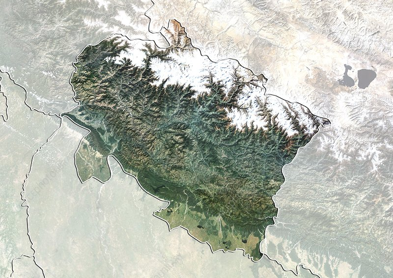
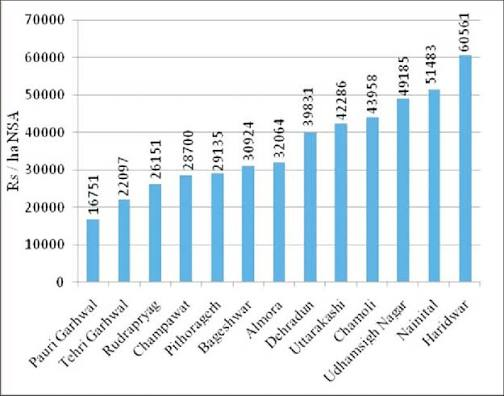
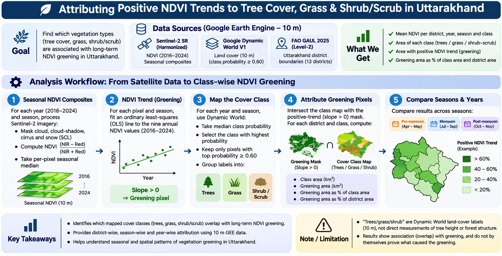
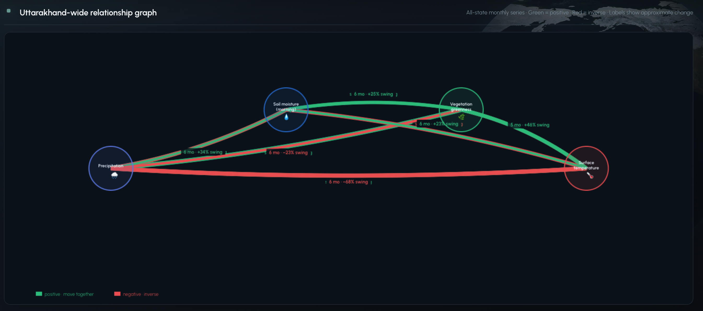
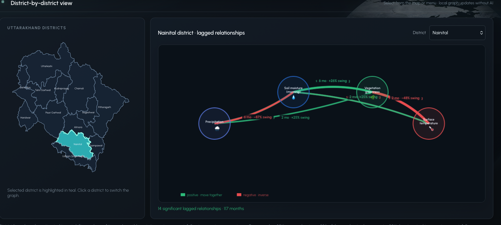

<p align="center">
  
</p>

<br/>

<p align="center">
  
</p>

<p align="center">
  
</p>

<p align="center">
  <sub>🛰️ &nbsp;<b>NASA International Space Apps Challenge 2026</b>&nbsp; · &nbsp;<i>"Be An Earth System Trend Detective"</i>&nbsp; · &nbsp;Uttarakhand, India</sub>
</p>

<br/>

<p align="center">
  <a href="https://thunderous-otter-920a93.netlify.app/">
    
  </a>
  &nbsp;
  <a href="https://github.com/Adirohansuyal/nasa2026">
    
  </a>
</p>

<br/>

<p align="center">
  
  &nbsp;
  
  &nbsp;
  
  &nbsp;
  
  &nbsp;
  
  &nbsp;
  
</p>

<br/>

<p align="center">
  
</p>


---

## What is EARTHPULSE-X?

EARTHPULSE-X is a **physics-aware, uncertainty-guided Earth system intelligence platform** that answers NASA's four core challenge questions using a decade of real satellite data over Uttarakhand, India.

| NASA Question | EARTHPULSE-X Answer |
|:---|:---|
| **WHAT** is changing? | LST declining (−0.173 K/yr) · NDVI rising (+0.00314/yr) |
| **WHERE** is it changing? | Pixel-level choropleth maps across all 13 Uttarakhand districts |
| **HOW MUCH** is changing? | Autocorrelation-corrected Sen's slope per variable |
| **Is it significant?** | Modified Mann-Kendall + FDR correction — not naive p-values |

> **Study Region:** Uttarakhand, India — 13 districts, Himalayas to foothills  
> **Time Period:** April 2015 – September 2025 (126 months)  
> **Spatial Resolution:** ~9 km × 9 km pixels · 50,449+ pixel-level records

---

## 📸 Screenshots

<table>
<tr>
<td align="center" width="50%">
  <br/>
  <sub><b>Study Region</b> — Uttarakhand from above</sub>
</td>
<td align="center" width="50%">
  <br/>
  <sub><b>Land Surface Temperature</b> trend map across districts</sub>
</td>
</tr>
<tr>
<td align="center" width="50%">
  <br/>
  <sub><b>NDVI</b> vegetation greenness — 10-year satellite composite</sub>
</td>
<td align="center" width="50%">
  <br/>
  <sub><b>Multi-method</b> statistical trend analysis output</sub>
</td>
</tr>
<tr>
<td colspan="2" align="center">
  <br/>
  <sub><b>EARTHPULSE-X</b> live dashboard</sub>
</td>
</tr>
</table>

---

## 🧠 The UG-ESI Framework

EARTHPULSE-X introduces **UG-ESI — Uncertainty-Guided Earth System Intelligence**, a 4-contribution methodology built on top of the NASA challenge requirements.

```
┌─────────────────────────────────────────────────────────────────────┐
│                        UG-ESI ARCHITECTURE                          │
│                                                                     │
│  [1] Adaptive Variable Selection                                    │
│      Two-pass greedy scoring (coverage · variability · trend ·      │
│      objective relevance) with redundancy penalty                   │
│               ↓                                                     │
│  [2] Multi-Scale Trend Intelligence                                 │
│      OLS · Mann-Kendall · Modified MK (Hamed & Rao 1998) ·         │
│      Sen's Slope · CUSUM change-points · FDR correction             │
│               ↓                                                     │
│  [3] Uncertainty-Guided Interaction Graph                           │
│      Spearman pairs · FDR-corrected · composite confidence ·        │
│      partial correlations to flag spurious edges                    │
│               ↓                                                     │
│  [4] Evidence-Grounded AI Reasoning                                 │
│      14 strict rules · actual stats injected as JSON context ·      │
│      AI explains; statistical engines establish facts               │
└─────────────────────────────────────────────────────────────────────┘
```

---

## 🛰️ Data Sources

| Satellite | Instrument | Variable | Resolution |
|:---|:---|:---|:---|
| **Terra / Aqua** | MODIS | 🌡️ Land Surface Temperature (LST, K) | ~1 km |
| **Terra / Aqua** | MODIS | 🌿 Vegetation Index (NDVI, 0–1) | ~500 m |
| **SMAP** | L-band passive microwave | 💧 Soil Moisture AM & PM (m³/m³) | ~9 km |
| **GPM** | Multi-satellite constellation | 🌧️ Monthly Precipitation (mm) | ~10 km |

> All data harmonized to monthly NetCDF grids (EPSG:6933 equal-area projection), then area-averaged to district scale via spatial join with Uttarakhand boundary polygons.

### Annual Land-Cover Map Frames — Data and Processing Workflow

The Land Cover timeline presents annual class maps and a pixel-wise comparison between consecutive years for Uttarakhand and its districts. The downloadable frames are generated by this project from annual label rasters; the land-cover classifications themselves are supplied by Google Dynamic World V1.

```mermaid
flowchart LR
    subgraph ROW1[ ]
        direction LR
        A[Copernicus Sentinel-2<br/>Level-1C observations] --> B[Google Dynamic World V1<br/>per-scene model inference] --> C[Class probabilities<br/>and 9-class labels] --> D[Google Earth Engine<br/>Dynamic World collection] --> E[Filter by Uttarakhand<br/>and calendar year] --> F[Per-pixel annual mode<br/>2015–2025; 2015 partial]
    end
    subgraph ROW2[ ]
        direction RL
        G[Annual categorical rasters<br/>100 m · EPSG:32644] --> H[Clip to state and<br/>district boundaries] --> I[Compare selected class<br/>between adjacent years] --> J[Encode lossless WebP<br/>frames and manifest] --> K[Leaflet playback over<br/>OpenStreetMap basemap]
    end
    F --> G
```



**Transition symbology:** pixels labelled as the selected class in both adjacent years retain the class color; newly labelled pixels are green; pixels that leave the class are blue.

#### Provenance and interpretation

- **Satellite input:** Dynamic World V1 is derived from **Copernicus Sentinel-2** imagery. Sentinel-2 is an ESA mission in the European Union's Copernicus programme; these land-cover frames should not be described as NASA-satellite observations. EARTHPULSE-X's other modules use NASA mission datasets, while this specific land-cover layer uses Dynamic World. [ESA Sentinel-2 mission](https://www.esa.int/Applications/Observing_the_Earth/Copernicus/Sentinel-2) · [Dynamic World V1 catalog](https://developers.google.com/earth-engine/datasets/catalog/GOOGLE_DYNAMICWORLD_V1)
- **Classification provider:** Dynamic World is produced by Google in partnership with the National Geographic Society and the World Resources Institute. Its model assigns per-observation probabilities to nine land-cover classes and provides a label for the highest-probability class. The workflow here uses those labels; it does not train a new classifier.
- **Annual compositing:** for each calendar year, the `label` band of all available Dynamic World observations intersecting the study region is reduced with a per-pixel mode in Earth Engine. The resulting annual map represents the most frequently assigned class among available observations, not a single-date image. Dynamic World begins on 27 June 2015, so the 2015 composite covers only part of that year.
- **Spatial export and frame rendering:** annual categorical labels are exported at 100 m nominal scale in EPSG:32644, cropped to FAO GAUL 2025 state/district geometries, colored, and encoded as lossless WebP files. For each selected class, the display marks pixels labelled as that class in both adjacent years in the class color, newly labelled pixels in green, and pixels no longer labelled as that class in blue. Pixels with missing labels are transparent.
- **Display resolution:** 100 m is the export grid used for this timeline; it is not the native resolution of Sentinel-2 or Dynamic World, whose source classifications are nominally 10 m. The timeline's WebP images are pre-rendered products; the browser displays them and does not rerun Earth Engine analysis during playback. OpenStreetMap tiles provide geographic context and are separate from the land-cover data.
- **Caveat:** annual modes can vary with observation availability, cloud and seasonal conditions, and classifier uncertainty. A displayed class transition is a change in annual model labels, not by itself field-verified land conversion.

The reproducible pipeline is [`research/download_dynamic_world_maps.py`](research/download_dynamic_world_maps.py) (Earth Engine raster export) followed by [`tools/build_static_landcover_frames.py`](tools/build_static_landcover_frames.py) (district clipping, symbology, year-to-year overlays, and WebP encoding). The interface loads these products through [`assets/landcover.js`](assets/landcover.js).

<p align="center">
  
</p>
<p align="center"><sub>Conceptual workflow illustration; the current implementation uses a multi-year cover composite for each season and does not export annual land-cover rows.</sub></p>

### Attributing Positive NDVI Trends to Tree Cover, Grass, and Shrub/Scrub in Uttarakhand

Rising NDVI indicates increasing vegetation greenness, but does not identify the vegetation type. To investigate whether greening pixels are labelled as tree cover, grass, or shrub/scrub, EARTHPULSE-X includes an exploratory Google Earth Engine workflow using 10 m source imagery: [`tools/forest_grass_attribution_gee.js`](tools/forest_grass_attribution_gee.js).

#### Data and method

- **Sentinel-2 Harmonized Level-1C (TOA) + Cloud Score+:** seasonal NDVI composites for the requested 2015–2025 period, with low-clear-sky-quality pixels masked using `cs_cdf >= 0.60`. Both collections begin on June 27, 2015, so pre-monsoon 2015 is unavailable. Actual first usable observations can vary by season and pixel; empty year-season windows are masked and skipped by the trend fit. [Sentinel-2 dataset](https://developers.google.com/earth-engine/datasets/catalog/COPERNICUS_S2_HARMONIZED) · [Cloud Score+ documentation](https://developers.google.com/earth-engine/datasets/catalog/GOOGLE_CLOUD_SCORE_PLUS_V1_S2_HARMONIZED)
- **Google Dynamic World V1:** per-pixel probabilities and labels for nine land-cover classes at 10 m. The analysis groups labels into **trees**, **grass**, and **shrub/scrub**, and retains pixels whose top-class probability is at least **0.60**. [Dynamic World dataset documentation](https://developers.google.com/earth-engine/datasets/catalog/GOOGLE_DYNAMICWORLD_V1)
- **District boundaries:** FAO GAUL 2025 level-2 administrative units. [GAUL dataset documentation](https://developers.google.com/earth-engine/datasets/catalog/FAO_GAUL_2025_level2)

For each district, season, and cover class, the export reports mean NDVI, estimated class area, area with a positive 2015–2025 seasonal NDVI trend, and the positive-trend area as a share of the class and district. The NDVI trend uses annual seasonal composites, while the land-cover labels are a single multi-year seasonal median composite. These summaries help answer which mapped cover classes overlap with long-term greening; they do not by themselves establish what caused the greening.

The source imagery and Dynamic World class probabilities are 10 m. They are aggregated to a common 100 m nominal-scale EPSG:6933 equal-area grid before trend and district calculations to keep the 2015–2025 analysis computationally tractable. Pixel areas are calculated from `pixelArea`; exported district areas are 100 m grid estimates, not 10 m measurements.

#### Analysis procedure: how the attribution is calculated

1. **Build seasonal NDVI composites:** for every available year from 2015 through 2025, the script filters harmonized Sentinel-2 imagery to Uttarakhand and the selected season. It links Cloud Score+ by Sentinel-2 scene ID, masks pixels with `cs_cdf < 0.60`, calculates NDVI from the near-infrared and red bands, then takes a per-pixel seasonal median. Pre-monsoon 2015 is omitted because these satellite records begin in late June 2015; masked fallback composites safely handle any other year-season window with no local scenes.
2. **Measure the NDVI trend:** for each pixel and season, it fits an ordinary least-squares line to the annual NDVI composites available in that season (2016–2025 pre-monsoon; 2015–2025 monsoon and post-monsoon). The fitted slope is NDVI change per year; pixels with slope greater than zero are marked as greening pixels.
3. **Map the period-level cover class:** for each season, it takes the median Dynamic World class probability across the available 2015–2025 observations, selects the class with the highest median probability, and keeps only pixels where that top median probability is at least 0.60. The retained labels are trees, grass, and shrub/scrub.
4. **Attribute greening pixels:** it intersects each season's period-level class map with the positive-trend mask. For every district and class, it sums the mapped class area and the area where NDVI slope is positive on the 100 m EPSG:6933 analysis grid, then calculates the positive-trend area as a percentage of the class area and district area.
5. **Compare seasons:** separate pre-monsoon, monsoon, and post-monsoon rows show whether the cover class overlapping positive NDVI trends differs by season. The export does not estimate annual land-cover transitions. “Trees” means the Dynamic World land-cover label; it is not a direct measurement of tree height or forest structure.

#### Run the analysis

1. Open [`tools/forest_grass_attribution_gee.js`](tools/forest_grass_attribution_gee.js) in the [Google Earth Engine Code Editor](https://code.earthengine.google.com/) while signed into an Earth Engine account.
2. Click **Run** and check the Console for the district list and export-ready status message. The expensive district table is evaluated by the batch CSV export rather than previewed in the interactive Console.
3. In the **Tasks** tab, start the CSV export and download the resulting table from Google Drive.

#### Interpretation and limitations

This is a **screening estimate**, not a validated forest-type map. Dynamic World's **trees** class is not an official forest boundary and does not prove forest recovery, plantation success, or woody biomass increase. Mixed pixels, cloud gaps, seasonal snow, steep slopes, and confusion between grass and shrubs can affect class labels. The 0.60 probability cutoff is a transparent analysis choice, not a locally calibrated accuracy threshold. Validate important locations against higher-resolution imagery, authoritative forest data, or field observations before making management claims.

An earlier export was generated in Earth Engine, but its map-preview layers showed a projection error. The script now sets the source projection before aggregation and uses an explicit equal-area output grid; rerun the updated script and export before relying on the earlier CSV's area estimates.

---

## 🗺️ Application — 10 Pages

| # | Page | What It Does |
|:--|:---|:---|
| 🧭 1 | **UG-ESI Mission Control** | Interactive 4-step workflow: select objective → score variables → trend analysis → AI research report |
| 🌍 2 | **Earth Observation** | Real NASA satellite heatmaps, pixel validity maps, 10-year temporal animation |
| 📈 3 | **Trend Detective** | NASA's 4 questions answered — Modified MK vs. naive MK comparison, Sen's slope, FDR correction |
| 🔎 4 | **Anomaly Intelligence** | District choropleth maps — Isolation Forest + robust Z-score on 50,449 pixel records |
| 🕸️ 5 | **Interaction Network** | FDR-corrected variable relationship network with partial correlation spurious-edge flagging |
| ⚗️ 6 | **Physics & Uncertainty** | Sensor coverage, quality threshold impact, physical plausibility checks, uncertainty propagation |
| 🔎 7 | **Earth Change Detective** | Monthly sensor anomaly timeline, district spread, and regional satellite evidence per selection |
| 🔮 8 | **Predictive Intelligence** | Custom AR-Fourier Ridge forecasting, rolling-origin cross-validation, Drought Risk Score (0–100) |
| 🚨 9 | **Early Warning System** | Simultaneous detection of 6 hazard types using all 5 sensors — Chamoli 2021 historical validation |
| 🔗 10 | **Causal Discovery** | Time-lagged partial correlations with Benjamini–Hochberg FDR correction across all variable pairs |

### 🚨 Early Warning System — 6-Hazard Detection

| Hazard | Sensor Pattern |
|:---|:---|
| 🌊 Flood | GPM high + SMAP high (saturated soil + heavy rain) |
| 🏜️ Drought | GPM low + SMAP low + LST high |
| 🔥 Heat Wave | LST high, SMAP near normal |
| 🍂 Vegetation Loss | NDVI low + LST high + SMAP low |
| ❄️ Cold Stress | LST anomalously low in warm season (Apr–Sep) |
| ⚡ Compound | ≥3 sensors simultaneously anomalous |

**Chamoli 2021 Historical Validation:** The Feb 7, 2021 glacial outburst flood (Tapovan dam, ~200 fatalities) is used as a ground-truth test of multi-sensor detection capability. Results are reported transparently — including what monthly satellite data could and could not resolve.

---

## ✨ Scientific Rigor — What Sets This Apart

### 1 · Autocorrelation-Corrected Significance Testing
Environmental time series are serially correlated — naive Mann-Kendall over-rejects the null.  
For LST (lag-1 autocorrelation = **0.549**):

| Test | p-value |
|:---|:---|
| Naive Mann-Kendall | 4 × 10⁻⁵ |
| Modified MK (Hamed & Rao 1998) | **p = 0.003** |

120× more conservative. Still significant — but honestly so. Both values are displayed side by side in the app.

### 2 · FDR Correction on All Tests
Benjamini–Hochberg FDR correction applied to trend tests (5 variables) and all 70+ Spearman interaction graph edges. Without this, false positives are mathematically guaranteed.

### 3 · No Selection Bias in Variable Ranking
Variables are scored on **data quality and signal properties — never on p-values**. Selecting variables for significance would invalidate all downstream inference (Freedman's paradox). The two-pass greedy algorithm also penalizes redundancy between correlated variables.

### 4 · Partial Correlations for Spurious Edge Detection
Interaction graph edges are flagged as "potentially spurious" when the partial correlation (controlling for the strongest confounder) drops below 50% of the raw Spearman ρ.

### 5 · Physics Engine
Physical plausibility bounds (LST 250–330 K, SMAP 0–0.60 m³/m³), cross-sensor diurnal consistency checks (SMAP AM vs PM), and sensitivity analysis under strict vs. relaxed quality thresholds.

---

## 📊 Key Findings

| Variable | Trend | Annual Rate | Significance |
|:---|:---:|:---|:---|
| 🌡️ Land Surface Temperature | **↓ Decreasing** | −0.173 K / year | ✅ FDR p = 0.003 |
| 🌿 Vegetation (NDVI) | **↑ Increasing** | +0.00314 / year | ✅ FDR p ≈ 1.5 × 10⁻⁶ |
| 💧 Soil Moisture AM | No significant trend | — | ⚪ Not significant |
| 💧 Soil Moisture PM | No significant trend | — | ⚪ Not significant |
| 🌧️ Precipitation | No significant trend | — | ⚪ Not significant |

> All trends computed with Modified Mann-Kendall (Hamed & Rao 1998) + Benjamini–Hochberg FDR correction over 126 months of data.

---

## 🔗 Causal Discovery — Methodology

The Causal Discovery page explores how four monthly satellite signals move together across Uttarakhand and whether a change in one signal is associated with a change in another signal in a later month.

**Signals used:**

| Short Name | Signal |
|:---|:---|
| GPM | Precipitation (rainfall) |
| SMAP_AM | Morning soil moisture |
| NDVI | Vegetation greenness |
| LST | Land surface temperature |

**Key methodological points:**
- **Partial correlation** accounts for other measured signals before measuring any two-signal relationship.
- **Time-lagged** analysis checks lags 0–6 months. At lag 2, January source values are compared with March target values.
- **Benjamini–Hochberg correction** controls the false discovery rate across all tested pairs and lags, with q-values replacing raw p-values.
- Results are **lagged statistical associations** and do not prove causation. All calculations run in-browser in `assets/causal.js` using ordinary JavaScript math.

<table>
<tr>
<td align="center" width="50%">
  <br/>
  <sub>Time-lagged correlation concept</sub>
</td>
<td align="center" width="50%">
  <br/>
  <sub>State-wide relationship graph</sub>
</td>
</tr>
<tr>
<td align="center" width="50%">
  <br/>
  <sub>District-level drill-down</sub>
</td>
<td align="center" width="50%">
  <br/>
  <sub>Benjamini–Hochberg FDR overview</sub>
</td>
</tr>
</table>

### 📖 Interpreting District-Level Signal Relationships

The app shows a table for every district that lists which signals are linked, by how much, and with what delay. Here is what that table looks like:

<p align="center">
  <br/>
  <sub>District relationship table — Chamoli district, real output from the app</sub>
</p>

Here is how to read it, using real rows from the data.

---

**The table has three columns:**

| Column | What it means |
|:---|:---|
| **Signals** | Which two things are connected, and in which direction (→ means one comes before the other; ↔ means they move together in the same month) |
| **Approximate Usual-Swing Change** | If the first signal goes up by its normal amount, how much does the second signal shift — expressed as a share of *its* normal range of movement |
| **When** | How many months later the second signal responds |

---

**Worked examples from Chamoli district:**

> **Surface temperature → Vegetation greenness · 40% lower · 1 month later**

In a typical month, surface temperature swings by a certain amount. When it rises by that usual amount in Chamoli, vegetation greenness tends to be about **40% lower than its own normal swing** — one month after. Hotter land this month usually means noticeably less green vegetation next month. In a high-altitude district like Chamoli, where glaciers and snowmelt influence ground temperature, this heat-stress on vegetation is particularly significant.

---

> **Precipitation (GPM) ↔ Soil moisture (morning) · 45% higher · Same month**

When rainfall goes up by its usual amount in Chamoli, morning soil moisture in that same month tends to be about **45% higher than its normal swing** — no delay. The ground soaks up the rain immediately. This is intuitive: more rain, wetter soil, right away. In Chamoli's steep Himalayan terrain, rapid soil saturation is also what makes the district prone to flash floods and landslides during heavy monsoon months.

---

> **Surface temperature → Vegetation greenness · 35% lower · 2 months later**

The same heat-stress relationship, but the effect shows up **two months later** instead of one. The land gets hot, and two months down the line the vegetation is still feeling it — greenness is about 35% below its normal variation. This lagged effect likely reflects the time it takes for heat stress to work through the growing cycle in Chamoli's mid-to-high altitude forests.

---

> **Vegetation greenness → Surface temperature · 32% lower · 2 months later**

This one runs the other direction: when vegetation greenness rises by its usual amount, surface temperature tends to be about **32% lower than normal** two months later. More plants → more shade and evapotranspiration → cooler land. This is the ecosystem feedback loop working in reverse — and it shows up clearly in Chamoli, where dense forest cover in the lower valleys actively moderates land temperature.

---

> **Soil moisture (morning) → Precipitation (GPM) · 54% lower · 6 months later**

A wetter-than-usual soil in Chamoli today is linked to **54% less rainfall six months later**. This is a slower, seasonal feedback — possibly reflecting how moisture gets locked into soil and snowpack during one phase of the year before the following dry season sets in. This is the longest lag detected in Chamoli's signal chain.

---

**What "usual swing" means — the key concept**

Each satellite signal fluctuates month to month. "Usual swing" is roughly the normal size of that fluctuation (think of it as one standard deviation of the signal's monthly anomaly). The percentage in the table does **not** mean "40% less rainfall in millimetres." It means: given a one-standard-deviation rise in the source, the target shifts by 40% of *its own* standard deviation. It is a relative, standardised measure — which is why you can compare a temperature relationship and a rainfall relationship on the same scale.

---

**What these results are — and are not**

- ✅ These are statistically significant associations after multiple-testing correction (Benjamini–Hochberg FDR, q < 0.05).
- ✅ The time direction (→) shows which signal leads, based on the lag at which the association was strongest.
- ❌ They do **not** prove that one signal *causes* the other. Unmeasured factors, seasonality, and district-level averaging can all create apparent links.
- ❌ The percentages are not prediction accuracy scores. They describe the typical *size* of the association, not how reliably it repeats every month.

Use these links as a starting point for investigation — they tell you *where to look*, not *what is definitely true*.

---

## 🤖 AI Stack

| Client | Model | Usage |
|:---|:---|:---|
| **Groq** | `openai/gpt-oss-120b` | Trend explainer, variable selection, interaction graph, research reports |
| **Google Gemini** | `gemini-3.8-flash` | Shared explanation client |
| **OpenRouter** | `meta-llama/llama-3.3-70b-instruct` | Vision-grounded chart explanations |

> All AI responses are **evidence-grounded** — actual statistical outputs are JSON-serialized and injected into every system prompt. The models explain; they do not invent.

---

## 🚀 Quick Start

### Prerequisites
- Python 3.11+
- API keys for Groq, Google Gemini, and OpenRouter

### 1. Clone and set up

```bash
git clone https://github.com/Adirohansuyal/nasa2026.git
cd nasa2026

python -m venv .venv
source .venv/bin/activate        # Windows: .venv\Scripts\activate
pip install -r requirements.txt
```

### 2. Configure environment

```bash
cp .env.example .env
# Add your API keys to .env
```

```env
GROQ_API_KEY=your_groq_api_key_here
GEMINI_API_KEY=your_gemini_api_key_here
OPENROUTER_API_KEY=your_openrouter_api_key_here
EARTHPULSE_PROJECT_ROOT=/path/to/your/EARTHPULSE_X/data/directory
```

### 3. Run the app

```bash
streamlit run app.py
```

Opens at `http://localhost:8501`.

### Static HTML + API server (Interaction Network / AI explanations)

```bash
# Terminal 1
uvicorn api_server:app --host 127.0.0.1 --port 8001

# Terminal 2
python -m http.server 5500
```

Open `http://localhost:5500`. Land Cover → District trends uses pre-rendered, class-colored WebP frames in `assets/landcover_frames/`; Netlify serves them from its CDN, and playback only preloads and displays images. To refresh the source rasters, run `research/.venv/bin/python research/download_dynamic_world_maps.py` with Earth Engine access, then rebuild the static frames with `research/.venv/bin/python tools/build_static_landcover_frames.py`. OpenStreetMap background tiles and the Leaflet library still load over the network.
The API remains necessary for AI explanations. For deployment, host it over HTTPS, set `EARTHPULSE_ALLOWED_ORIGINS` to the site origin, and point `window.EARTHPULSE_API_BASE` in `index.html` to the API's public base URL.

---

## 📁 Project Structure

```
nasa2026/
│
├── app.py                              # Entry point, page registration
├── config.py                           # Data paths, study region, constants
├── api_server.py                       # OpenRouter proxy (FastAPI)
├── requirements.txt
│
├── pages/
│   ├── 01_Mission_Control.py           # UG-ESI interactive 4-step workflow
│   ├── 02_Earth_Observation.py         # Satellite data heatmaps & validity
│   ├── 03_Trend_Detective.py           # NASA 4 questions answered
│   ├── 04_Anomaly_Intelligence.py      # District anomaly choropleth maps
│   ├── 05_Interaction_Network.py       # FDR-corrected variable network
│   ├── 06_Physics_Uncertainty.py       # Data quality & physics checks
│   ├── 07_AI_Scientist.py              # Evidence-grounded AI chat
│   ├── 08_Predictive_Intelligence.py   # AR-Fourier forecast + VAR
│   ├── 09_Early_Warning_System.py      # 6-hazard multi-sensor EWS
│   └── 10_Causal_Discovery.py          # Time-lagged partial correlations
│
├── core/
│   ├── ai_agent.py                     # Centralized AI prompt functions
│   ├── anomaly_engine.py               # UG-ESI C1: Variable selection
│   ├── trend_engine.py                 # UG-ESI C2: Multi-method trend analysis
│   ├── interaction_engine.py           # UG-ESI C3: Interaction graph
│   ├── early_warning_engine.py         # 6-hazard detection rules
│   ├── forecast_engine.py              # AR-Fourier Ridge forecasting
│   ├── lagged_dynamics.py              # Cross-variable VAR lag model
│   ├── physics_engine.py               # Physical plausibility checks
│   ├── spatial_hotspot_engine.py       # DBSCAN pixel clustering
│   ├── spatial_trend_engine.py         # District-scale NetCDF trends
│   ├── data_loader.py                  # Cached CSV/NetCDF loaders
│   ├── gemini_client.py                # Google Gemini client
│   └── openrouter_client.py            # OpenRouter / Llama vision client
│
├── components/
│   ├── theme.py                        # Custom dark UI theme
│   ├── charts.py                       # Reusable Plotly chart functions
│   ├── maps.py                         # GeoPandas → Plotly map utilities
│   └── sidebar.py                      # Shared sidebar component
│
└── assets/                             # Images, JS bundles, precomputed data
```

---

## 👨‍🚀 Team

<p align="center">
  <em>The minds behind EARTHPULSE-X — analyzing the land we call home.</em>
</p>

<table align="center">
  <tr>
    <td align="center" width="200">
      <br/><br/>
      <strong>Aditya Suyal</strong>
    </td>
    <td align="center" width="200">
      <br/><br/>
      <strong>Gaurav Negi</strong>
    </td>
    <td align="center" width="200">
      <br/><br/>
      <strong>Nisha Kumari</strong>
    </td>
    <td align="center" width="200">
      <br/><br/>
      <strong>Ritesh</strong>
    </td>
  </tr>
</table>

<p align="center">
  🏔️ <em>Team from Uttarakhand — analyzing the land we call home.</em>
</p>

---

<p align="center">
  Built with 🛰️ NASA satellite data &nbsp;·&nbsp; 🧪 rigorous statistics &nbsp;·&nbsp; 🤖 evidence-grounded AI<br/><br/>
  <a href="https://thunderous-otter-920a93.netlify.app/"><strong>🚀 Live Demo</strong></a>
  &nbsp;&nbsp;|&nbsp;&nbsp;
  <a href="https://github.com/Adirohansuyal/nasa2026"><strong>💻 GitHub</strong></a>
</p>
